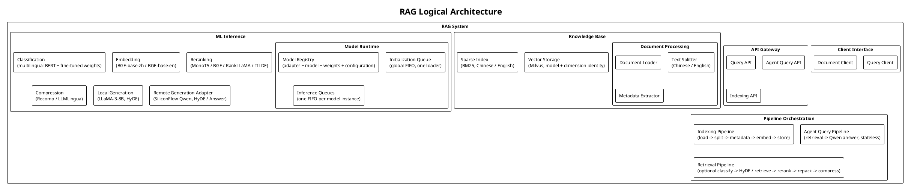
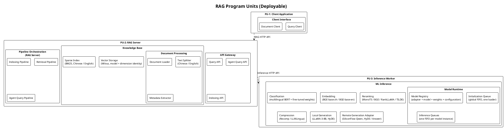
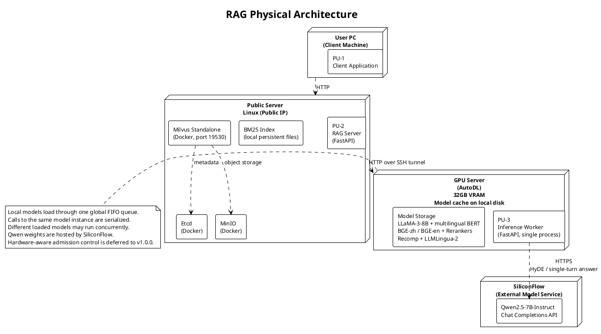
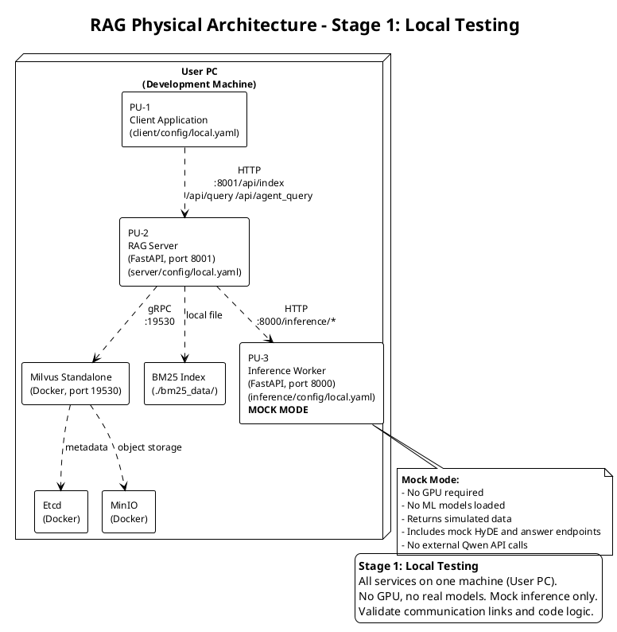
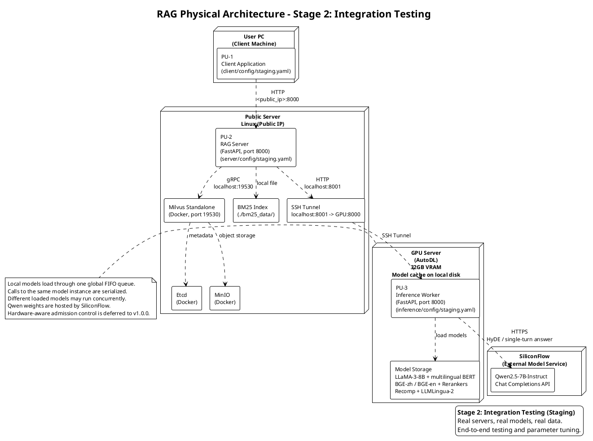
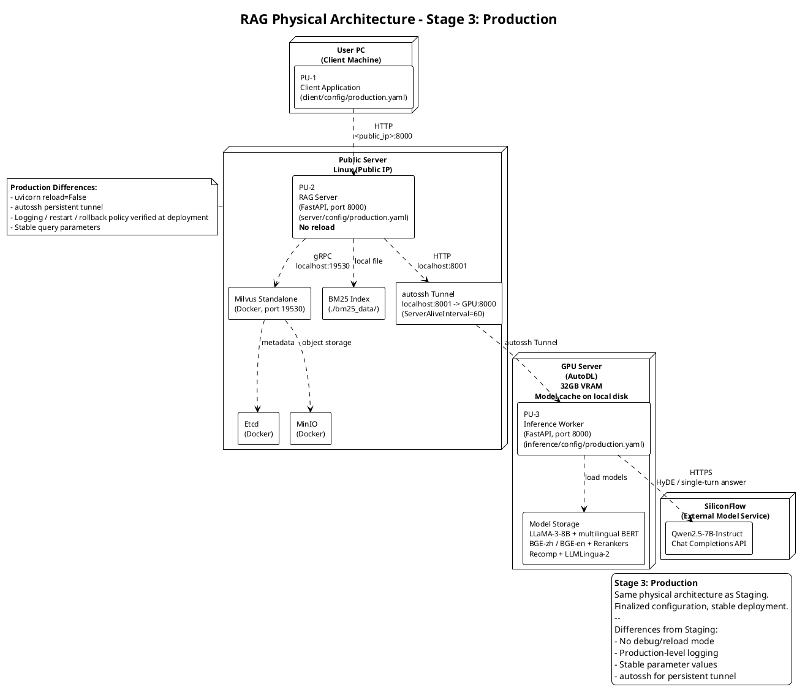

# v0.1.0 架构定义

## 范围与基线

本目录替代 `docs/architecture/` 中对应的六个架构视图，保留原始编号、文件职责、分层方式及 PU 标识。原目录已归档于 `docs/v0.0.0/architecture/`。新增中文模型、请求级模型选择、模型运行时及单轮回答均纳入完整系统结构，不单独形成一套脱离原架构的功能示意图。

PlantUML 源码为架构定义的维护入口，PNG 直接由该源码渲染生成。

架构前后差异及迁移影响见[架构修改与重构清单](../方案.md#architecture-changes)。本目录展示当前结构，清单用于定位相对旧版的修改。

## 视图对应关系

| 源文件 | 视图职责 | 对应关系 |
| --- | --- | --- |
| [05_logical_architecture.puml](05_logical_architecture.puml) | 功能组成及逻辑归属 | 定义客户端、接口、知识库、推理和编排模块 |
| [06_program_units.puml](06_program_units.puml) | 可部署程序划分 | 将逻辑模块分配至 PU-1、PU-2、PU-3 |
| [07_physical_architecture.puml](07_physical_architecture.puml) | 机器、程序与基础设施的总体分布 | 将三个 PU 映射到客户端、公网服务器及 GPU 服务器；标明外部 Qwen 服务 |
| [08_physical_architecture_local.puml](08_physical_architecture_local.puml) | local 部署 | 三个 PU 同机；Mock Worker；本地存储及通信 |
| [09_physical_architecture_staging.puml](09_physical_architecture_staging.puml) | staging 部署 | 真实模型、分布式程序、SSH 隧道、外部 Qwen API |
| [10_physical_architecture_production.puml](10_physical_architecture_production.puml) | production 部署 | 同一物理分工下的最终配置、持久隧道和运行约束 |

## 跨视图分配

| 逻辑模块 | 程序单元 | local 节点 | staging / production 节点 |
| --- | --- | --- | --- |
| Client Interface | PU-1 Client Application | 开发机 | 用户电脑 |
| API Gateway、Pipeline Orchestration | PU-2 RAG Server | 开发机 | 公网服务器 |
| Document Processing、Vector Storage 访问、Sparse Index 访问 | PU-2 RAG Server | 开发机 | 公网服务器 |
| ML Inference、Model Runtime、Remote Generation Adapter | PU-3 Inference Worker | 开发机，Mock 实现 | GPU 服务器，真实模型及远程调用 |
| Milvus、etcd、MinIO | 存储基础设施，非额外 PU | 开发机容器 | 公网服务器容器 |
| BM25 索引文件 | PU-2 的持久化数据 | 开发机文件系统 | 公网服务器文件系统 |
| Qwen Chat Completions | 外部模型服务 | 不调用 | SiliconFlow；由 PU-3 发起 HTTPS 请求 |

逻辑图和程序图中的 Vector Storage 表示知识库的向量存储能力及访问模块，不表示 Milvus 数据库嵌入 Server 进程。图中的程序间依赖、节点通信和包含关系沿用原始 `.puml` 表达方式。流程顺序与排队行为的详细约束由[技术方案](../方案.md)定义。

## Logical Architecture



[PlantUML](05_logical_architecture.puml)

## Program Units



[PlantUML](06_program_units.puml)

## Physical Architecture



[PlantUML](07_physical_architecture.puml)

## Physical Architecture — Local



[PlantUML](08_physical_architecture_local.puml)

## Physical Architecture — Staging



[PlantUML](09_physical_architecture_staging.puml)

## Physical Architecture — Production



[PlantUML](10_physical_architecture_production.puml)

## 生成与校验

采用 PlantUML 1.2025.4、Java 21，在本地执行语法校验并生成 PNG/SVG。保留原 `plain` 主题、矩形 package、无阴影和默认字体大小。使用 PlantUML 内置 Smetana 布局，避免外部 Graphviz 依赖；不再使用 Pillow 手工绘制架构元素。

```bash
python scripts/render_v010_architecture.py \
  --java /path/to/java \
  --jar /path/to/plantuml-1.2025.4.jar
```

渲染工具先执行 `-checkonly -failfast2`，通过后分别执行 `-tpng` 与 `-tsvg`。本轮仅读取原 `.puml` 源码并校验生成文件，未进行图片查看。PlantUML 语法检查不替代系统架构的人工评审。
